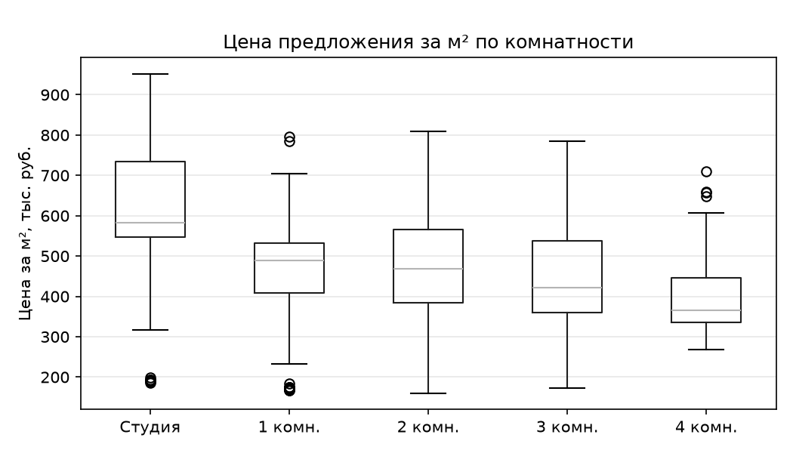
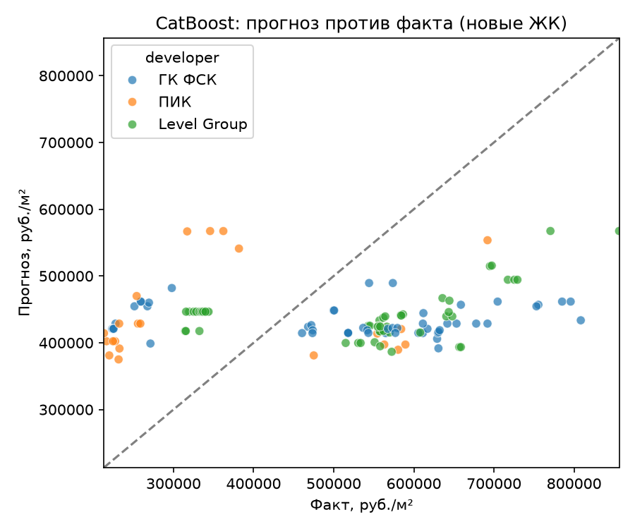

# Отчёт: прогноз цены предложения за м² в новостройках

**Цель проекта** - построить воспроизводимый ML-пайплайн для прогноза цены предложения за м² (`asking_price_per_m2_rub`) в новостройках и проверить его качество на жилых комплексах, которых модель не видела при обучении.

---

## 1. Сбор, очистка и исследование данных

Исходный набор (804 объявления, 41 ЖК трёх застройщиков: ПИК, ГК ФСК, Level Group; дата индексации - 12.11.2026) дополнен **39 новыми объявлениями** из двух публичных каталогов ГК ФСК («Симоновский Вал» - 19, «Архитектор» - 20) по снимкам от 19.11.2026.

**Ключевые проверки и решения:**
- **Объём и дубликаты:** после объединения получено **843 объявления из 42 ЖК**. Полных дубликатов и совпадений по ID квартиры между исходными и собранными данными не обнаружено, ни одна строка не удалялась.
- **Корректность значений:** 0 записей с некорректной площадью, ценой или этажом (этаж строго от 1 до этажности дома). Опубликованная цена за м² во всех строках сходится с расчётной (`asking_price_rub / area_m2`) в пределах 2,5%. Дорогие квартиры не отбрасывались.
- **Пропуски и неоднородность:** `finish` отсутствует в 74,9% строк (в т.ч. в 100% новых записей ФСК и у Level Group), `floors_total` - в 22,5%, `handover_text` - в 53,3%. Пропуски не заменялись нулями, `rooms = 0` сохранено как студия.
- **Распределение и дисбаланс:** медианная площадь - 45,3 м², медианная цена - 484 528 руб./м² (IQR: 383 900 - 557 875 руб./м²). Цена за м² снижается с ростом комнатности (от 582 493 руб./м² у студий до 365 059 руб./м² у 4-комнатных) - см. диаграмму ниже. Объявления распределены по ЖК неравномерно: на «Левел Южнопортовую» приходится 244 из 843 объявлений (29% выборки).

---

## 2. Признаки и защита от утечки

- **Исключены из-за утечки цели:** `asking_price_rub`, `asking_price_per_m2_rub`, `original_price_rub`, `discount_pct`.
- **Исключены технические и групповые поля:** `record_id`, `listing_number`, `source_url`, `project`, `project_group` (используется только для группового разбиения).
- **Базовый набор признаков:** `developer`, `rooms`, `area_m2`, `floor`.
- **Расширенный набор (проверялся в экспериментах):** базовый + `finish` (пропуски как «Не указано») + `relative_floor` (`floor / floors_total`).

Предобработка вынесена в `src/preprocessing.py` и одинаково применяется в `train.py` и `predict.py`.

---

## 3. Эксперименты и выбор модели

Для честной оценки переноса на новые ЖК все решения по признакам и гиперпараметрам принимались **только на 5-фолдовой групповой кросс-валидации (`GroupKFold` по `project_group`) внутри обучающей части** (716 строк, 29 ЖК). Отложенный групповой тест (127 строк, 13 ЖК; 0 общих ЖК с обучением) до финальной оценки не использовался.

1. **Медианный baseline** (медиана по `developer` и `rooms` с запасной общей медианой): средний MAE на групповой CV - **133 825 руб./м²**.
2. **Ridge (`alpha=1.0`, `StandardScaler` + `OneHotEncoder`):**
   - Замена `area_m2` на `log1p(area_m2)` снизила MAE с 139 877 до **136 695 руб./м²**.
   - Добавление расширенных признаков (`finish`, `relative_floor`) ухудшило MAE до 140 555 руб./м² - оставлен базовый набор с `log1p(area_m2)`.
3. **CatBoost (`loss_function="MAE"`, `seed=42`):**
   - На дефолтных параметрах (`iterations=500, depth=6, lr=0.05`) базовый набор дал MAE 144 321 руб./м², расширенный - хуже (155 705 руб./м²), поэтому выбран базовый набор.
   - Подбор гиперпараметров через **Optuna** (20 попыток на тех же 5 групповых фолдах с `early_stopping_rounds=30`) снизил средний CV MAE на 24% - до **109 051 руб./м²**. Лучшая конфигурация: `depth=3`, `learning_rate=0.1866`, `iterations=15`.

По итогам групповой CV (средний MAE 109 051 руб./м² против 133 825 у baseline и 136 695 у Ridge) в качестве итоговой модели выбран **CatBoost (базовый набор, параметры Optuna)**. Выбор сделан до оценки на отложенных тестах. Отложенный групповой тест это преимущество не подтвердил: медианный baseline показал меньшую MAE (150 755 против 165 286 руб./м²). Поэтому в `predict.py` поставляется выбранная по CV конфигурация, а не модель, которая лучше всех показала себя на тесте.

---

## 4. Качество на случайном и групповом тестах

Сравнение всех трёх моделей на двух отложенных выборках: случайный тест (20% объявлений, 169 строк, 30 из 32 ЖК есть в train) и групповой тест (30% ЖК, 127 строк, 13 ЖК, 0 пересечений с train).

Основной сценарий проекта - прогноз на ранее не встречавшихся группах ЖК (`project_group`). Поэтому набор признаков и гиперпараметры каждой модели выбирали по групповой кросс-валидации внутри `group_train`. Для случайного разбиения модели заново обучили на `random_train`, сохранив выбранные конфигурации. Отдельный подбор не проводили: цель сравнения - показать результаты одних и тех же конфигураций при двух способах разбиения, а не найти лучшую модель для каждого сценария.

Случайная оценка носит диагностический характер: 140 из 169 строк `random_test` входили в `group_train` и были доступны при выборе признаков Ridge и CatBoost и гиперпараметров CatBoost. Поэтому случайные метрики этих моделей не являются независимой оценкой выбранных конфигураций. Медианный baseline такого подбора не проходил. Групповой тест не использовался для выбора конфигураций и служит основной оценкой качества.

| Модель | Случайное разбиение: MAE*, руб./м² | Случайное разбиение: MedAPE* | Новые ЖК MAE, руб./м² | Новые ЖК MedAPE |
|---|---:|---:|---:|---:|
| Медианный baseline | 86 136 | 11,1% | 150 755 | 28,0% |
| Ridge (`log1p(area_m2)`) | 89 582 | 13,0% | 158 532 | 27,5% |
| CatBoost (Optuna) | 89 093 | 12,6% | 165 286 | 31,7% |

**\*** Диагностическая оценка. Для Ridge и CatBoost случайный тест не был изолирован от этапа выбора конфигурации.

**Как менялось качество на новых ЖК и почему baseline оказался лучше на тесте:**
- На групповом тесте MAE выше у всех трёх подходов. Однако эту разницу нельзя целиком приписать появлению незнакомых ЖК: отличаются состав и размер тестовых выборок, а случайная оценка Ridge и CatBoost не независима от подбора. Название и идентификатор ЖК не использовались как признаки, поэтому результаты не показывают, что модели запомнили цены конкретных комплексов.
- На новых ЖК ошибка вырастает почти вдвое у всех моделей: среди признаков нет локации, класса жилья и удалённости от метро, а именно они задают основной разброс цены за м² между комплексами.
- Несмотря на победу CatBoost на групповой CV (109 тыс. против 134 тыс. у baseline), на отложенных 13 ЖК его MAE оказался выше, чем у baseline (165 тыс. против 151 тыс.). При 29 ЖК в обучении и 13 ЖК в тесте оценка сильно зависит от того, какие именно комплексы попали в тест.

---

## 5. Анализ ошибок по сегментам и вклад признаков

На групповом тесте (127 строк) для итогового CatBoost:
- **По застройщикам:** наибольшая относительная ошибка у **ПИК** (MedAPE 64,9%, MAE 176 403 руб./м², n=22), далее ГК ФСК (MedAPE 32,7%, MAE 174 779 руб./м², n=52) и Level Group (MedAPE 29,2%, MAE 151 357 руб./м², n=53).
- **По комнатности:** наибольшая ошибка у студий (MAE 209 463 руб./м², n=7) и 4-комнатных (MAE 264 185 руб./м², n=2); минимальная - у 3-комнатных (MAE 143 050 руб./м², n=30).
- **По диапазонам фактических цен:** модель прогнозирует в узком коридоре ~370-570 тыс. руб./м² при фактическом разбросе 200–850 тыс. руб./м² (см. диаграмму рассеяния ниже). Поэтому в нижнем ценовом сегменте (213–460 тыс., n=43) MedAPE достигает 62,1%, а в верхнем (580–856 тыс., n=42) MAE достигает 219 271 руб./м².
- **Permutation importance (20 повторов на групповом тесте):** перемешивание `floor` (+5 938 руб./м²) и `developer` (+3 016 руб./м²) ухудшает MAE, а перемешивание `area_m2` (−11 334 руб./м²) и `rooms` (−2 311 руб./м²) даже снижает ошибку - зависимость цены от площади, выученная на train, плохо переносится на тестовые ЖК.

---

## 6. Десять ценовых отклонений и разбор трёх примеров

Отклонение рассчитывалось как `100 × (факт / прогноз − 1)`. Ниже - 5 самых отрицательных и 5 самых положительных отклонений на групповом тесте:

| Застройщик | ЖК | Комн. | Площадь, м² | Этаж | Факт, руб./м² | Прогноз, руб./м² | Отклонение | URI |
|---|---|---:|---:|---:|---:|---:|---:|---:|
| ПИК | Восточное Бутово | 2 | 56,3 | 17 | 213 200 | 414 333 | −48,5% | [https://www.pik.ru](https://www.pik.ru/search/finish?metroStations=1ee78b52-11ac-6004-8279-d7f06b038fc5&projects=1&rooms=0) |
| ГК ФСК | Римский | 2 | 57,6 | 5 | 227 599 | 428 711 | −46,9% | [https://fsk.ru](https://fsk.ru/moskva/living/kvartiry-bez-otdelki) |
| ГК ФСК | Римский | 2 | 63,8 | 10 | 223 491 | 420 901 | −46,9% | [https://fsk.ru](https://fsk.ru/moskva) |
| ГК ФСК | Римский | 2 | 63,4 | 11 | 224 755 | 420 901 | −46,6% | [https://fsk.ru](https://fsk.ru/moskva/living/kvartiry-bez-otdelki) |
| ГК ФСК | Римский | 2 | 63,4 | 12 | 225 150 | 420 901 | −46,5% | [https://fsk.ru](https://fsk.ru/moskva/living/kvartiry-bez-otdelki) |
| ГК ФСК | Сидней Сити | 2 | 46,5 | 7 | 808 435 | 433 653 | +86,4% | [https://fsk.ru](https://fsk.ru/moskva/2-komnatnye-kvartiry/etazh-7) |
| ГК ФСК | Сидней Сити | 1 | 39,1 | 8 | 795 804 | 461 667 | +72,4% | [https://fsk.ru](https://fsk.ru/moskva/s-otdelkoj-rjadom-s-metro/etazh-8) |
| ГК ФСК | Сидней Сити | 1 | 37,4 | 8 | 785 097 | 461 667 | +70,1% | [https://fsk.ru](https://fsk.ru/moskva/s-otdelkoj-rjadom-s-metro/etazh-8) |
| Level Group | Левел Мичуринский, этапы 3 и 4 | 4 | 91,5 | 37 | 658 699 | 393 544 | +67,4% | [https://level.ru](https://level.ru/filter/4k-kvartiry-ot-level-group/page7/) |
| Level Group | Левел Мичуринский, этапы 3 и 4 | 4 | 91,5 | 35 | 656 759 | 393 544 | +66,9% | [https://level.ru](https://level.ru/filter/4k-kvartiry-ot-level-group/page7/) |

**Разбор трёх кейсов:**
1. **ПИК — «Восточное Бутово» (−48,5%):** цена предложения - 213 200 руб./м², прогноз - 414 333 руб./м². Относительно базового значения SHAP (461 тыс. руб./м²) наибольшие отрицательные вклады дали площадь (−27 тыс.) и застройщик (−19 тыс.). «Восточное Бутово» и ЖК «Римский» находятся в Московской области, у четырёх квартир в «Римском» цена предложения также оказалась ниже прогноза на 46,5-46,9%. Локация - возможный фактор: модель не получает её напрямую, а эти примеры не позволяют оценить её вклад отдельно от других характеристик.
2. **ГК ФСК — «Сидней Сити» (+86,4%):** цена предложения - 808 435 руб./м², прогноз - 433 653 руб./м². ФСК позиционирует проект как премиальный жилой квартал на Шелепихинской набережной. Модель не получает класс и локацию ЖК напрямую, поэтому могла не учесть часть различий между этим комплексом и другими проектами ФСК. У двух однокомнатных квартир в том же ЖК цена предложения также выше прогноза - на 70,1% и 72,4%.
3. **Level Group — «Левел Мичуринский, этапы 3 и 4» (+67,4% и +66,9%):** две 4-комнатные квартиры по 91,5 м² на 35–37 этажах с фактом ~657–659 тыс. руб./м² при прогнозе 393 544 руб./м². Возможно, модель сильно занижает прогноз для больших площадей и 4-комнатных квартир (в выборке 4-комнатных всего 39, а на тесте - 2, поэтому по этой паре нельзя судить обо всём сегменте), не учитывая видовой высокий этаж и класс жилья.

---

## 7. Ограничения и следующие шаги

**Главные ограничения:**
- Малый объём выборки (843 строки, 42 ЖК) и сильный перекос по отдельным ЖК.
- Разная давность индексации страниц и отсутствие данных о фактических сделках.
- Отсутствие географических признаков и класса ЖК - главного фактора цены за м² на новых комплексах.

**Следующие шаги при развитии проекта:**
- Добавить геопризнаки: координаты ЖК, расстояние до ближайшего метро и центра, административный округ / замкадье.
- Расширить датасет до 2 000+ объявлений из большего числа ЖК в единый временной срез, с унифицированной отделкой и сроком сдачи.